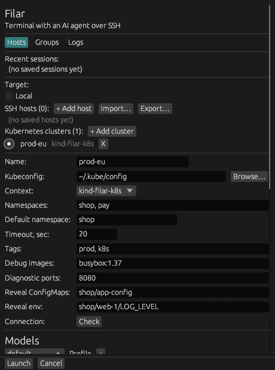
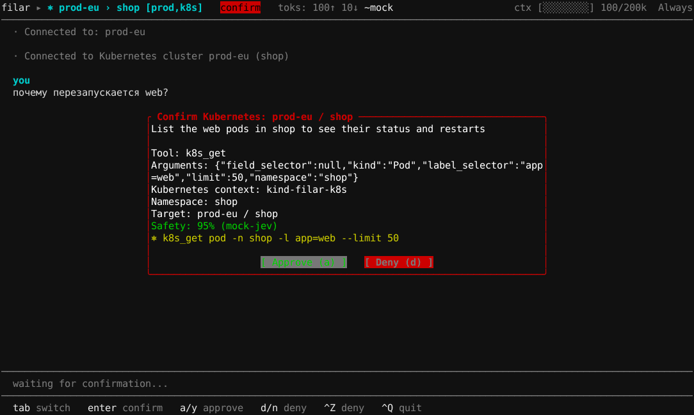
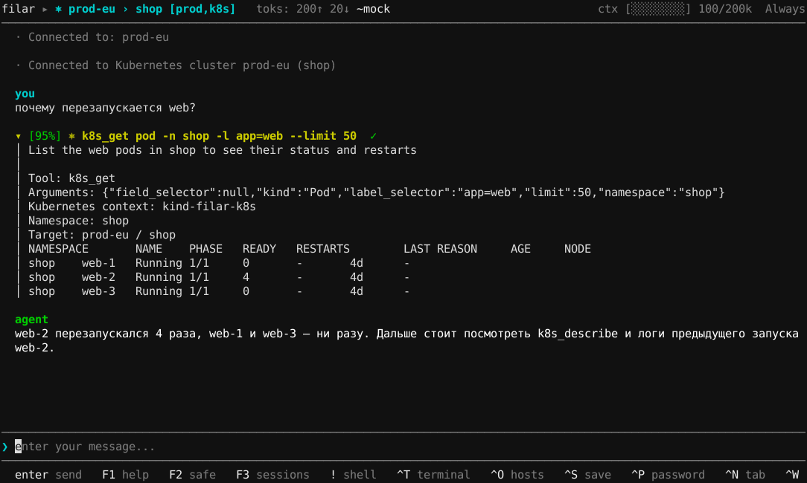
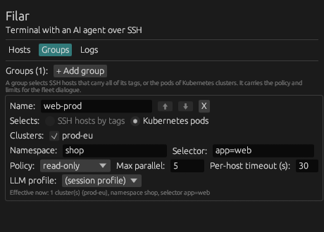
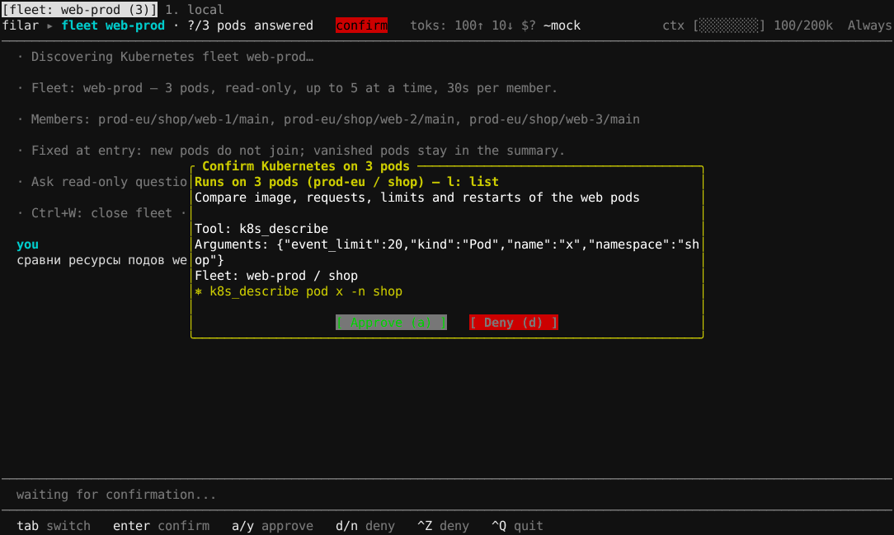
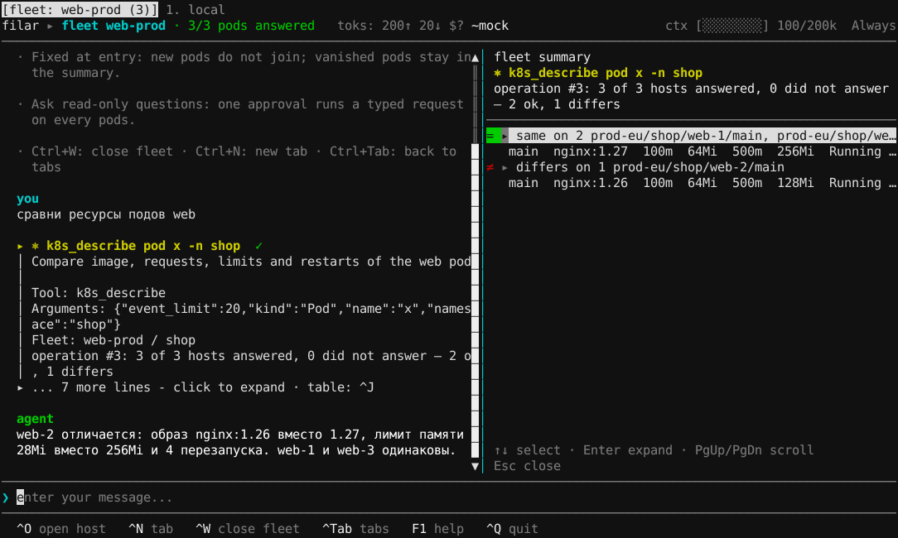

# Kubernetes в filar

Как работать с Kubernetes в filar: подключение кластера, вкладки кластера и
пода, debug-контейнер, логи приложений и флот подов. Документ описывает
поведение версии 3.0.4. Ключи `config.toml` собраны в справочнике
[USER_GUIDE.md, 2.2](../USER_GUIDE.md#22-configtoml--справочник). Здесь — как
ими пользоваться.

- [1. Модель: что такое цель и что видит агент](#1-модель-что-такое-цель-и-что-видит-агент)
- [2. Подключение кластера](#2-подключение-кластера)
- [3. Карточка кластера в лаунчере](#3-карточка-кластера-в-лаунчере)
- [4. Вкладка кластера](#4-вкладка-кластера)
- [5. Вкладка пода и debug-контейнер](#5-вкладка-пода-и-debug-контейнер)
- [6. Kube-группы и флот подов](#6-kube-группы-и-флот-подов)
- [7. Логи приложений](#7-логи-приложений)
- [8. Типичные проблемы](#8-типичные-проблемы)

---

## 1. Модель: что такое цель и что видит агент

**Цель — кластер и namespace, а не под.** Кластер в filar — это один контекст
kubeconfig, записанный в `[[kube_clusters]]`. Во вкладке кластера выбран один
namespace. Поды эфемерны: их выбирают уже внутри кластера (вкладка пода,
флот по селектору), а не заводят целями.

**Агент работает через типизированные запросы к API.** Во вкладке кластера у
модели нет шелла и нет `kubectl`. Читает она инструментами `k8s_get`,
`k8s_describe`, `k8s_logs`, `k8s_events`, `k8s_top`, `k8s_rollout_history`,
`pod_http_get`, а при настроенных источниках логов — ещё `query_logs` и
`pod_logs_history`. Значения объектов `Secret` агенту недоступны.

**Запись в кластер** (3.0.5) идёт только через отдельные инструменты записи —
`k8s_apply`, `k8s_scale`, `k8s_rollout`, `k8s_delete` (гейт — #639, инструменты
появляются в #640–#642 той же вехи; пока их нет, вкладка кластера только
читает и получает прежний read-only промпт) — и только через гейт
([4.2](#42-когда-спрашивается-подтверждение)): каждое изменение сначала
выполняется на API-сервере как dry run и показывается вам с diff, и ничего не
меняется, пока вы не подтвердите, — в любом режиме, включая `allowlist` и
`never`. filar не держит своего списка запретов на виды объектов: предел —
права RBAC контекста из kubeconfig. Флоту инструменты записи не даются вовсе.

Особый случай —
`pod_http_get`: это `GET` к эндпоинту самого приложения, и что делает
эндпоинт, решает приложение. Поэтому без вопроса он уходит только к
диагностическим путям, а любой другой путь (`/reset`, `/admin/…`)
подтверждается в любом режиме ([4.5](#45-http-диагностика-пода-pod_http_get)).

**Что живёт только у вас.** В `config.toml` записываются имя кластера, путь к
kubeconfig и имя контекста. Содержимое kubeconfig — сертификаты, токены,
настройки exec-плагинов — filar не копирует ни в конфиг, ни в
`pending_launch.json`, ни в сессию. Запросы идут с вашей машины напрямую в
API-сервер, без промежуточных серверов (инвариант 5 из
[AGENTS.md](../AGENTS.md)). Сохранённая сессия помнит только имя кластера,
namespace, а у вкладки пода — селектор или имя пода и контейнер.

**Что уходит модели и как скрываются секреты.** Каждый ответ API проходит
редакцию до того, как попадёт к модели, в историю или экспорт сессии:

- значения переменных окружения контейнеров заменяются на `«скрыто»`;
- для `valueFrom` остаётся только ссылка (`secretKeyRef: db-creds/password`),
  без значения;
- в ConfigMap скрывается значение, если его ключ похож на секретный
  (`password`, `token` и т. п.), если в нём есть учётные данные, токен или
  присваивание секрета, если у него высокая энтропия или длина от 256
  символов; `binaryData` скрывается целиком;
- аннотация `kubectl.kubernetes.io/last-applied-configuration` удаляется;
- в логах и аргументах команд скрываются bearer-токены, `user:pass@` в URL
  и флаги вида `--password=…`.

Точечные исключения задаются полями кластера `reveal_configmaps` и
`reveal_env` ([раздел 3](#3-карточка-кластера-в-лаунчере)). Раскрытое значение
модель видит с пометкой `«раскрыто настройкой»`.

**Чем это отличается от SSH-цели.**

| | SSH-хост | Кластер Kubernetes |
|---|---|---|
| Что делает агент | команды шелла | типизированные запросы к API: чтение и, во вкладке кластера, запись через гейт |
| Подтверждение | каждой команды по режиму confirm | каждого запроса по тем же правилам ([4.2](#42-когда-спрашивается-подтверждение)) |
| Шелл | постоянный шелл хоста | только во вкладке пода, шелл из образа контейнера |
| Изменения на цели | команды агента могут менять хост — после подтверждения по режиму confirm (в `never` — сразу); передать файл можно и самому (`Ctrl+G`); у хоста из группы с политикой `read-only` запись отклоняется до отправки | вкладка кластера — чтение API, а запись только инструментами записи после dry run и подтверждения в любом режиме ([4.2](#42-когда-спрашивается-подтверждение)); флот — только чтение; вкладка пода — команды в контейнере, как на SSH-хосте; в спецификацию пода — только debug-контейнер по `Ctrl+B` |

Инварианты AGENTS.md для Kubernetes означают следующее:

- **Zero-install.** Чтобы работать, filar ничего своего в кластер не ставит:
  ни агента, ни оператора, ни сайдкаров. Вкладка пода использует шелл, который
  уже есть в образе. `pod_http_get` идёт через port-forward API, не открывая
  локальный порт.
- **Изменения — через confirm-гейт.** Запись в объекты Kubernetes — это
  инструменты записи агента (подтверждение всегда, после dry run и diff,
  [4.2](#42-когда-спрашивается-подтверждение)) и debug-контейнер. Цель меняют
  и команды в поде, и `pod_http_get` к эндпоинту приложения; у них свои
  правила подтверждения ([4.5](#45-http-диагностика-пода-pod_http_get)).
  Debug-контейнер добавляете вы сами по `Ctrl+B`, после отдельного окна
  подтверждения ([5.2](#52-debug-контейнер-ctrlb)). Агент его создать не
  может.
- **Confirm-гейт.** Запросы к API подтверждаются по тем же правилам, что
  команды. Флот подтверждается всегда, одним окном на всех членов.

---

## 2. Подключение кластера

### 2.1. `[[kube_clusters]]`

Локальный kind-кластер (`kind create cluster --name filar-k8s` создаёт контекст
`kind-filar-k8s`):

```toml
[[kube_clusters]]
name = "kind"                     # имя цели в filar
context = "kind-filar-k8s"        # контекст kubeconfig, обязательно
namespaces = ["default", "shop"]  # что предлагать в Ctrl+O
default_namespace = "shop"
tags = ["k8s", "dev"]
debug_images = ["busybox:1.37"]   # иначе Ctrl+B недоступен
```

Облачный кластер (EKS) с отдельным kubeconfig и тегом `prod`:

```toml
[[kube_clusters]]
name = "prod-eu"
context = "arn:aws:eks:eu-central-1:111122223333:cluster/prod-eu"
kubeconfig = "~/.kube/prod-eu.yaml"
namespaces = ["shop", "pay"]
default_namespace = "shop"
request_timeout_secs = 30
tags = ["prod", "k8s"]
debug_images = ["busybox:1.37", "nicolaka/netshoot:v0.13"]
diagnostic_ports = [8080, 6060]
```

Оба примера проходят проверку конфигурации: `filar --target kind/shop` и
`filar --target prod-eu/shop` открывают вкладку кластера.

**Почему `context` обязателен.** filar никогда не смотрит на
`current-context`. Его можно переключить в соседнем терминале
(`kubectl config use-context`), и запрос ушёл бы не в тот кластер. Пустой
`context` — ошибка при запуске:
`kube_clusters: "prod-eu": context must not be empty (current-context is never used)`.

Другие правила разбора:

- имена целей уникальны среди SSH-хостов и кластеров вместе: `--target` и
  `Ctrl+O` ищут в одном списке;
- имена namespace — по DNS-1123 (строчные буквы, цифры, `-`, до 63 символов);
- `default_namespace` должен входить в `namespaces`, если список задан;
- `request_timeout_secs` — от 1 до 120, по умолчанию 20.

Ошибка всегда называет кластер и поле.

### 2.2. Exec-плагины (`aws`, `gcloud`, `kubelogin`)

Облачные kubeconfig обычно получают токен через exec-плагин:
`aws eks get-token`, `gke-gcloud-auth-plugin`, `kubelogin get-token`. filar
запускает его так же, как `kubectl`, — по описанию в kubeconfig, на вашей
машине. Плагин должен быть установлен и находиться в `PATH` того процесса, из
которого запущен filar. Токен остаётся в памяти клиента и никуда не
записывается.

Если плагин не запустился или не выдал токен, подключение заканчивается
ошибкой `Kubernetes target prod-eu (context …): cannot load the explicit
context or its credentials`. Проверьте плагин в том же терминале:
`kubectl --context <контекст> get ns`.

### 2.3. Прокси и `NO_PROXY`

Прокси выбирается так же, как у `kubectl`:

1. `proxy-url` у кластера в kubeconfig — сильнее всего;
2. иначе `HTTPS_PROXY` / `https_proxy` из окружения;
3. прокси из окружения не используется, если адрес API-сервера подходит под
   `NO_PROXY` / `no_proxy`.

Формы `NO_PROXY`:

- `corp` — сам хост и его поддомены;
- `.corp` и `*.corp` — только поддомены;
- IP-адрес, CIDR (`10.0.0.0/8`), `*`;
- запись с портом (`host:6443`).

Правила действуют для всех соединений с кластером: запросов агента, шелла
пода, терминала `Ctrl+T` и port-forward. Кривой `HTTPS_PROXY` даёт ошибку
`the HTTPS_PROXY address cannot be parsed`.

### 2.4. Проверка и вход

- **Лаунчер → Hosts → кластер → Check** делает один read-only запрос списка
  подов в namespace по умолчанию. Ответ — `Available: N pod(s) in <namespace>`
  или понятная ошибка контекста, RBAC или соединения.
- **CLI:**
  - `filar --target prod-eu` — namespace по умолчанию;
  - `filar --target prod-eu/shop` — сразу `shop`;
  - `filar --target prod-eu/shop/app=web` — сразу вкладка пода
    ([5.1](#51-вкладка-пода-ctrle)).
- **`Ctrl+O`** в TUI показывает кластеры рядом с SSH-хостами. После выбора
  кластера открывается список namespace:
  - если `namespaces` задан — из него, с выбранным `default_namespace`;
  - иначе filar запрашивает namespace у API, для этого нужно право `list` на
    `namespaces`.

  `Esc` отменяет ожидание.

---

## 3. Карточка кластера в лаунчере

Лаунчер → вкладка **Hosts** → **+ Add cluster** или выбор существующего
кластера. При **Launch** поля записываются в `[[kube_clusters]]` в
`config.toml`. Сертификаты, токены и содержимое kubeconfig не записываются.



Серый текст в поле — пример значения. Что значит поле и что значит пустое
значение, показывает подсказка при наведении на название поля или на само поле.

| Поле | Ключ | Что значит | Формат | Пусто | Пример |
|---|---|---|---|---|---|
| **Name** | `name` | Имя цели в filar: `--target`, `Ctrl+O`, ярлык вкладки `name/namespace` | строка, уникальна среди хостов и кластеров | ошибка при Launch | `prod-eu` |
| **Kubeconfig** | `kubeconfig` | Файл kubeconfig. **Browse…** только выбирает путь, файл не копируется | путь, `~` раскрывается | `$KUBECONFIG`, затем `~/.kube/config` | `~/.kube/prod-eu.yaml` |
| **Context** | `context` | Контекст kubeconfig: сервер, пользователь, учётные данные. Список читается из файла локально, без обращения к API | один из контекстов файла | ошибка: `current-context` не используется | `kind-filar-k8s` |
| **Namespaces** | `namespaces` | Какие namespace предлагать в `Ctrl+O`. Это список выбора, а не разграничение доступа | через запятую, DNS-1123 | список запрашивается у API (нужно право `list` на `namespaces`) | `shop, pay` |
| **Default namespace** | `default_namespace` | В каком namespace открывается вкладка | DNS-1123, должен входить в Namespaces, если они заданы | вкладка без namespace по умолчанию; в `Ctrl+O` выбран первый из списка | `shop` |
| **Timeout, sec** | `request_timeout_secs` | Таймаут одного запроса к API | целое 1–120 | — (по умолчанию 20) | `20` |
| **Tags** | `tags` | Теги кластера. Участвуют в `[[tag_policies]]`, в подсветке окна подтверждения (`prod`) и в целях арбитра и оценщика | через запятую | без тегов | `prod, k8s` |
| **Debug images** | `debug_images` | Образы, которые `Ctrl+B` может добавить в под как debug-контейнер ([5.2](#52-debug-контейнер-ctrlb)) | через запятую, ссылки на образы без пробелов | `Ctrl+B` недоступен | `busybox:1.37` |
| **Diagnostic ports** | `diagnostic_ports` | Порты пода, которые `pod_http_get` может читать сверх объявленных в спецификации контейнера | через запятую, 1–65535 | только объявленные порты | `8080, 6060` |
| **Reveal ConfigMaps** | `reveal_configmaps` | ConfigMap, значения которых модель видит без редакции | через запятую, `namespace/name` | всё скрывается по правилам редакции | `shop/app-config` |
| **Reveal env** | `reveal_env` | Переменные окружения конкретного пода, значения которых модель видит | через запятую, `namespace/pod/VARIABLE` | все значения env скрыты | `shop/web-1/LOG_LEVEL` |

Если список Debug images пуст, под полем серой строкой написано
`Empty = Ctrl+B unavailable.`

**Что из этого попадает в модель.** Kubeconfig, контекст и учётные данные — нет.
Модель знает имя кластера, namespace и теги: они входят в системный промпт и
в описание цели для арбитра и оценщика. Reveal-поля — единственный способ
показать модели значение, которое иначе скрыто:

- `Reveal ConfigMaps` раскрывает все значения указанного ConfigMap;
- `Reveal env` раскрывает одну буквальную переменную одного пода. Ссылки
  `valueFrom` (например на Secret) остаются ссылками.

Раскрытое значение помечено `«раскрыто настройкой»`, чтобы было видно, откуда
модель его знает. По умолчанию — без Reveal-полей — модель не видит ни одного
значения env и ни одного похожего на секрет значения ConfigMap.

---

## 4. Вкладка кластера

### 4.1. Какие запросы есть

| Инструмент | Что делает | Ограничения |
|---|---|---|
| `k8s_get` | Список объектов: Pod, Deployment, StatefulSet, DaemonSet, ReplicaSet, Job, CronJob, Node, Service, Endpoints, Ingress, ConfigMap, Namespace | селекторы меток и полей, до 100 строк; `Secret` нет |
| `k8s_describe` | Один объект с событиями: причины завершения, requests и limits контейнеров | те же виды объектов |
| `k8s_logs` | Хвост лога контейнера, текущего или предыдущего запуска (`--previous`) | до 500 строк и 1 МиБ, после редакции |
| `k8s_events` | События namespace или объекта | лимит строк |
| `k8s_top` | Потребление CPU и памяти подов или нод | нужен metrics-server |
| `k8s_rollout_history` | История ревизий Deployment | лимит строк |
| `pod_http_get` | `GET` эндпоинта пода (`/metrics`, `/healthz`, pprof) через port-forward API | порт объявлен в контейнере или в `diagnostic_ports`; ответ до 1 МиБ |
| `query_logs` | Поиск в хранилище логов ([7](#7-логи-приложений)) | только при `[[log_sources]]` |
| `pod_logs_history` | История логов пода из хранилища | только при источнике с `clusters = ["…"]` |

В ленте запрос выглядит как сворачиваемый блок `⎈ k8s_get pod -n shop --limit 50`.
В ASCII-наборе символов вместо `⎈` пишется `k8s:`.



### 4.2. Когда спрашивается подтверждение

Режим берётся так же, как для команд (`confirm_mode`, `F2`):

- `always` и `explain` — каждый запрос показывается в окне подтверждения:
  инструмент, аргументы, контекст, namespace и строка `Target: prod-eu / shop`;
- `allowlist` и `never` — запросы на чтение выполняются сразу. Запись сюда
  не относится: она подтверждается всегда (см. ниже). Исключение — `pod_http_get` к пути вне диагностического
  списка: он спрашивается всегда ([4.5](#45-http-диагностика-пода-pod_http_get)).

`[[tag_policies]]` по тегам кластера режим только ужесточают. Например,
политика на тег `prod` с `confirm_mode = "always"` заставит спрашивать каждый
запрос к такому кластеру даже в `allowlist`. Кластер с тегом `prod` выделяет
окно подтверждения как производственное.

**Запись в кластер подтверждается всегда**, в любом режиме, включая
`allowlist` и `never`. Перед окном запрос выполняется на API-сервере с
`dryRun=All`:

- если dry run отказан (нет права RBAC, отказ admission, ошибка валидации) —
  окно не открывается, отказ сразу виден в ленте и уходит агенту: ничего не
  изменено;
- иначе окно показывает инструмент, контекст, namespace, строку `Target:` и
  по каждому объекту действие (created / configured / unchanged, удаление,
  реплики «было → станет») и diff текущего объекта против результата dry run.
  Шум убран: `managedFields`, `resourceVersion`, `status` (кроме ресурсов
  без подресурса `status`, где он пишется вместе с объектом),
  `last-applied-configuration`. У `Secret` вместо значений — ключи и признак
  «значение изменится»;
- удаление и уменьшение реплик до 0 (даже уже пустого workload) — деструктивные: окно красное, с
  предупреждением; кластер с тегом `prod` тоже даёт красное окно;
- удаление по селектору удаляет ровно те объекты, что показал dry run;
  откат без явной ревизии идёт ровно к той, что показал dry run, даже если
  за время окна завершился другой rollout.

Арбитр и оценка безопасности работают для записи так же, как для чтения;
арбитр смотрит каждое окно, в том числе в режиме `never`.
После выполнения в ленте и в экспорте сессии остаётся строка «Изменение в
кластере: <действие> <вид> <ns>/<имя> (контекст …, время)». Агенту уходит
краткий итог без значений `Secret`; полный diff видите только вы.

### 4.3. Арбитр и оценка безопасности

- **Арбитр** ([USER_GUIDE.md, 4.5](../USER_GUIDE.md#45-подтверждение-команд))
  проверяет каждый запрос, который вы подтверждаете: typed `k8s_*`,
  `query_logs`, `pod_logs_history`, во вкладке кластера и во флоте. Вердикт
  показан в окне подтверждения. Он ничего не одобряет и не блокирует. В режиме
  `never` арбитр не запускается.
- **Оценка безопасности** (`[risk_scorer]`) оценивает каждый запрос вкладки
  кластера в любом режиме подтверждения. Окно открывается сразу: сначала
  `Safety: rating…`, потом процент. В ленте у блока появляется бейдж
  `[95%]`. Оценщику передаются запрос в том виде, в каком он показан в ленте,
  пояснение агента и цель — кластер, namespace запроса и теги. Запуски флота
  не оцениваются.



### 4.4. Ограничения

- **Нет metrics-server — нет `k8s_top`.** Ответ: `Unsupported: metrics.k8s.io
  is not available for pods (context …)`. Остальные инструменты работают.
- **RBAC.** Отказ приходит в блок результата как `нет права <verb> на
  <resource> в namespace <ns> (контекст …)`, после чего диалог продолжается.
  Агент работает с правами пользователя контекста и не обходит отказ.
- **Нет шелла.** `Ctrl+T`, `Ctrl+G` и `!cmd` отвечают «во вкладке кластера нет
  шелла; войдите в под — Ctrl+E».

### 4.5. HTTP-диагностика пода (`pod_http_get`)

Многие приложения отдают свои эндпоинты: `/metrics` (Prometheus), `/healthz`
и `/readyz`, pprof у Go, Actuator у Spring. Агент читает их через port-forward
в API кластера. Шелл в поде не нужен, в кластере ничего не создаётся,
локальный порт не открывается, поэтому это путь и для distroless-подов.

- Только `GET` и только относительный путь, без схемы и хоста. Символ `%`
  запрещён целиком — и в пути, и в query (`?q=a%20b` тоже отклоняется).
- Порт должен быть объявлен в спецификации контейнера (номер или имя) или
  перечислен в `diagnostic_ports` кластера.
- Ответ больше 1 МиБ обрезается с пометкой; есть таймаут.
- pprof — только индекс `/debug/pprof/` и текстовые профили `?debug=1`, с
  `seconds` не больше 30.
- Для `/metrics` агент видит только запрошенные метрики или топ значений, а
  не весь вывод. Метки вроде `password` и известные секреты маскируются.

**Когда спрашивается подтверждение.** К API кластера `pod_http_get` только
читает, но `GET` к приложению может что-то изменить: самописный `/reset`,
`/admin/flush-cache`. Поэтому режим действует только для диагностических путей:

- `/metrics`;
- `/healthz`, `/livez`, `/readyz`, `/health`, `/ready`;
- `/actuator/health`, `/actuator/info`, `/actuator/prometheus`;
- pprof: индекс `/debug/pprof` и `/debug/pprof/` и текстовые профили в
  границах выше; `debug` и `seconds` — не больше одного раза.

Путь сравнивается целиком и без query, даже пустого (`/metrics?`,
`/metrics?x=1` и `/healthz/` уже не диагностические); у pprof query разрешён.
Путь с сегментом `.` или `..` или с обратной косой чертой не диагностический
никогда: сервер превратит `/debug/pprof/../../reset` в `/reset`. В `allowlist` и `never` такие
запросы уходят без вопроса. Любой другой путь подтверждается **в любом
режиме**, и окно подтверждения добавляет строку `Path is not on the diagnostic
list: the application may change its state.` Политики тегов по-прежнему только
ужесточают: на кластере с тегом под `always` спрашиваются и диагностические
пути.

Нужно право RBAC `create` на `pods/portforward`. Пример запроса: «покажи
метрики пода web».

### 4.6. Ярлыки вкладок и сессии

Вкладка кластера подписана `кластер/namespace`, например `prod-eu/shop`.
Вторая вкладка с тем же ярлыком получает `#2`, третья — `#3`. Ярлык длиннее
32 колонок обрезается. Статус-бар показывает `⎈ prod-eu › shop [prod]`
(в ASCII — `k8s: prod-eu > shop [prod]`).

При сохранении сессии записываются только имя кластера и namespace. `F3`
находит кластер по имени в текущем `[[kube_clusters]]`, подключается заново и
восстанавливает namespace.

---

## 5. Вкладка пода и debug-контейнер

### 5.1. Вкладка пода (`Ctrl+E`)

Во вкладке кластера с выбранным namespace `Ctrl+E` (или `Ctrl+O` → «⎈ Войти в
под…») открывает список запущенных подов. Можно печатать часть имени. Текст
с `=` — это селектор (`app=web`): вкладка войдёт в первый готовый под по
нему, а при пересоздании пода перейдёт в новый. Под открывается в новой
вкладке, вкладка кластера остаётся.

Вкладка пода — это шелл внутри контейнера через `exec`, как SSH-шелл на
хосте. Агент выполняет команды, `cd` и переменные сохраняются, `!команда`
работает, каждая команда подтверждается по режиму confirm. Используется шелл
из образа, ничего не ставится. Статус-бар показывает известные ограничения
контейнера (`non-root · ro-fs · mem 512Mi`), полный список — в `F1` → **Pod**.

Прямо из терминала:

```bash
filar --target prod-eu/shop/web-7f9c4d5b8-x2k9p   # под по имени
filar --target prod-eu/shop/app=web              # первый готовый под по селектору
```

- **Подключение** идёт в фоне. Пока шелл не открыт, ввод отклоняется («Под …
  ещё подключается: ничего не выполнено»): команда не уйдёт на локальную
  машину под именем пода.
- **Подтверждение** показывает строку цели `context prod-eu · namespace shop ·
  pod web-7f9c… · container main`. Теги кластера участвуют в `[[tag_policies]]`
  и в оценке безопасности так же, как теги SSH-хоста.
- **Память.** Процессы из шелла считаются в лимит памяти того же контейнера,
  что и приложение: тяжёлые команды могут привести к OOM-kill приложения.
- **Смена пода.** Если вкладка открыта по селектору, а под пересоздали,
  следующая команда идёт в новый под. В ленте появляется строка «Под web-7f9c…
  пропал, вкладка теперь в web-a1b2… — cd и переменные сброшены».
- **Отказы.** Нет права `create` на `pods/exec`, запрет политики допуска, нет
  пода или шелла в образе — понятное сообщение в ленте, и вкладка
  возвращается на кластер и namespace, откуда входили.
- **Сессии.** Сохраняются кластер, namespace, селектор или имя пода и
  контейнер. `F3` заново входит в под по ним.

`Ctrl+T` во вкладке пода открывает интерактивный терминал контейнера с TTY,
как `kubectl exec -it`: `top`, редакторы, изменение размера окна, `Ctrl+C`
прерывает команду в контейнере. Это отдельный exec, независимый от шелла
агента. `cd` агента переносится в терминал при открытии.

### 5.2. Debug-контейнер (`Ctrl+B`)

**Когда нужен.** В distroless-образе или образе `FROM scratch` нет
`/bin/sh`, и войти в под нельзя. В этом случае лента подсказывает:

- если `debug_images` задан — «Войти в такой под можно через debug-контейнер:
  Ctrl+B»;
- если пуст — «Войти можно через debug-контейнер (Ctrl+B), но у prod-eu пуст
  debug_images: лаунчер → Hosts → Debug images»;
- в обоих случаях — «Логи, describe и события пода агент читает и без шелла —
  спросите во вкладке кластера».

**Что происходит.** `Ctrl+B` добавляет в под эфемерный контейнер с
инструментами, как `kubectl debug --target`. Если container runtime узла
поддерживает `targetContainerName` (containerd и CRI-O — да), он делит
пространство процессов с целевым контейнером: процесс приложения обычно PID 1, его файлы видны в
`/proc/1/root/…`. Если в поде включён `shareProcessNamespace`, PID 1 — это
`pause`, и агент ищет процесс приложения по `/proc/*/cmdline`. После запуска
открывается вкладка пода в debug-контейнере с меткой `debug` в статус-баре;
`Ctrl+T` открывает терминал в нём же. При закрытии вкладки шелл завершается,
а запись в спецификации пода остаётся. Нажать `Ctrl+B` можно во вкладке кластера (сначала выбор
пода и контейнера) или во вкладке пода (её под и контейнер). При нескольких
образах будет предложен выбор.

**Что остаётся в спецификации пода.** Контейнер `filar-debug-<id>` остаётся в
`spec.ephemeralContainers` до пересоздания пода, удалить его нельзя. Поэтому:

- перед созданием открывается окно с текстом «…Он останется в спецификации
  пода до его пересоздания; удалить его нельзя. Создать?». Создать можно
  только клавишей `y`; `n` и `Esc` отменяют. Для кластера с тегом `prod` окно
  красное;
- след записывается в ленту и в экспорт сессии: «След в кластере: в под
  shop/web-… добавлен эфемерный контейнер filar-debug-… (образ …, target main,
  время)»;
- агент debug-контейнер не создаёт и создать не может.

**Права debug-контейнера** не шире целевого контейнера:

- тот же `runAsUser` и `runAsGroup` (контейнера, иначе пода);
- `runAsNonRoot`, `readOnlyRootFilesystem` и seccomp-профиль, если они заданы у
  цели;
- `privileged: false`, `allowPrivilegeEscalation: false`,
  `capabilities.drop: [ALL]`.

Если спецификация не называет пользователя цели (он берётся из `USER`
образа), debug-контейнер запускается как `nobody` (UID и GID 65534,
`runAsNonRoot: true`). Иначе образ debug-контейнера мог бы стартовать от root.

### 5.3. Права на debug-контейнер (RBAC)

`debug_images` ничего не разрешает: это лишь список образов, из которых можно
выбрать. Контейнер создаётся от имени пользователя контекста kubeconfig, как
при `kubectl debug`. Нужные шаги и права в namespace пода (по коду
`crates/transport/src/cluster/debug.rs` и входа в под `cluster/exec.rs`):

| Шаг | Запрос к API | Право |
|---|---|---|
| выбрать под (`Ctrl+B` во вкладке кластера) | `LIST pods` | `list` на `pods` |
| прочитать под и его securityContext | `GET pods/<pod>` | `get` на `pods` |
| добавить эфемерный контейнер | `PATCH pods/<pod>/ephemeralcontainers` (strategic merge) | `patch` на `pods/ephemeralcontainers` |
| дождаться запуска | `GET pods/<pod>` в цикле, до 90 с | `get` на `pods` |
| открыть шелл | `exec` в `filar-debug-<id>` | `create` на `pods/exec` (и `get`, если API-сервер авторизует exec по WebSocket как `get`) |

Минимальные `Role` и `RoleBinding` на один namespace:

```yaml
apiVersion: rbac.authorization.k8s.io/v1
kind: Role
metadata:
  name: filar-debug
  namespace: shop
rules:
  - apiGroups: [""]
    resources: ["pods"]
    verbs: ["get", "list"]
  - apiGroups: [""]
    resources: ["pods/ephemeralcontainers"]
    verbs: ["patch"]
  - apiGroups: [""]
    resources: ["pods/exec"]
    verbs: ["create", "get"]   # get — для exec по WebSocket в новых API-серверах
---
apiVersion: rbac.authorization.k8s.io/v1
kind: RoleBinding
metadata:
  name: filar-debug-oncall
  namespace: shop
subjects:
  - kind: Group
    name: oncall-shop        # дежурные этого namespace
    apiGroup: rbac.authorization.k8s.io
roleRef:
  kind: Role
  name: filar-debug
  apiGroup: rbac.authorization.k8s.io
```

**Условия кластера помимо RBAC:**

- Kubernetes 1.25 или новее: эфемерные контейнеры там GA.
- Admission-политики (Pod Security Admission, Kyverno, Gatekeeper) могут
  запретить добавление. Контейнер filar — с пользователем и группой цели
  (иначе `nobody`), `privileged: false`, без эскалации, `capabilities.drop:
  [ALL]`. Профиль `restricted` такой контейнер обычно пропускает, если
  пропускает сам под.
- Узел должен скачать образ из `debug_images`: нужен доступ к registry, а для
  приватного — `imagePullSecrets` пода.
- Container runtime узла должен поддерживать общее пространство процессов с
  целью (`targetContainerName`); иначе контейнер либо не запустится (filar
  покажет причину и запишет след), либо запустится без доступа к процессам
  приложения.

**Что увидите при отказе.** Сообщения разные, без повторов:

- **RBAC.** «Debug-контейнер filar-debug-… в поде shop/web-… не создан: нет
  права patch на pods/ephemeralcontainers в namespace shop (контекст …)».
- **Admission-политика.** Тот же префикс, а за ним дословный текст отказа от
  API-сервера.
- **Отказ после добавления.** Образ не скачался или контейнер не запустился за
  90 с. Тогда контейнер уже в спецификации пода, поэтому в ленту записывается
  след, а затем «Debug-контейнер … добавлен в спецификацию пода …, но не
  запустился: образ не скачался или не запустился: ImagePullBackOff …».

**Оценка риска для администратора кластера.** Право `patch` на
`pods/ephemeralcontainers` позволяет запустить свой образ рядом с процессами
любого пода в namespace и видеть их файлы и память. Давайте его точечно:
дежурным и по namespace, а не всем разработчикам.

**Проверить права заранее:**

```bash
# --context и --kubeconfig — те же, что у кластера в filar (поля Context и Kubeconfig)
kubectl auth can-i patch pods/ephemeralcontainers -n shop --context <контекст> --kubeconfig <файл>
kubectl auth can-i create pods/exec -n shop --context <контекст> --kubeconfig <файл>
kubectl auth can-i get pods/exec -n shop --context <контекст> --kubeconfig <файл>
```

На kind контекст по умолчанию — `cluster-admin`, поэтому `Ctrl+B` работает
сразу. В продовом кластере проверьте права до инцидента.

### 5.4. Что нельзя

- `kubectl debug --copy-to` (копия пода) и `kubectl debug node/…`
  (привилегированный под на ноде) filar не делает.
- Файловые панели `Ctrl+G` во вкладке пода пока недоступны.

---

## 6. Kube-группы и флот подов

### 6.1. Зачем

Флот подов задаёт **один вопрос сразу всем подам группы** — в одном или
нескольких кластерах — и показывает, **чем они различаются**. Типичные находки:

- под с другим образом после неполного выката;
- под с другими requests/limits, у которого память кончается раньше
  остальных;
- под, который перезапускается, когда остальные стоят;
- разное потребление CPU и памяти при одинаковой нагрузке.

Флот только читает: typed `k8s_*`, без шелла. Поэтому он работает и с
distroless-подами.

### 6.2. Создание группы

**В лаунчере:** вкладка **Groups** → **+ Add group** → **Selects: Kubernetes
pods**. Затем отметьте кластеры, укажите **Namespace** и **Selector**.
Пустой Selector означает, что поды не ищутся: членом флота становится каждая
пара кластер/namespace ([6.3](#63-как-фиксируются-члены)).



**В `config.toml`:**

```toml
[[host_groups]]
name = "web-prod"
kube = { clusters = ["prod-eu", "prod-us"], namespace = "shop", selector = "app=web" }  # оба — из [[kube_clusters]]
max_parallel = 5
per_host_timeout_secs = 30
```

`match` (SSH-теги) и `kube` в одной группе вместе нельзя. Если в Match tags
SSH-группы введён тег кластера, лаунчер подскажет переключиться на
Kubernetes pods.

### 6.3. Как фиксируются члены

Вход — `filar --group web-prod` или `Ctrl+O` → группа (отмечена `⎈`).

- **С `selector`** filar один раз находит готовые поды в каждом кластере.
  Членами становятся пары под/контейнер.
- **Без `selector`** членами становятся пары кластер/namespace.

Состав фиксируется при входе. Новые поды во флот не попадают, после операции
filar пишет `появились поды, не вошедшие во флот: …`. Пропавший под остаётся в
сводке со статусом `pod disappeared`.

**Радиус одобрения.** Каждый запрос подтверждается одним окном на весь флот, в
любом режиме confirm, включая `never`. Окно показывает радиус
`Runs on 3 pods (prod-eu / shop) — l: list`, а `l` раскрывает полный список
членов. `Ctrl+J` открывает боковую панель со сводкой и таблицей различий.



### 6.4. Как читать вывод

Пример — вопрос «сравни ресурсы подов web» во флоте из трёх подов, у одного из
которых другой образ, лимит памяти и перезапуски. Вывод снят с текущей сборки
против тестового API-сервера и взят из экспорта сессии `Ctrl+S`:

```
operation #3: 3 of 3 hosts answered, 0 did not answer — 2 ok, 1 differs
operation #3 · kubernetes · 3 hosts · 3 compared, 0 dropped
compared on: CONTAINER, IMAGE, CPU REQUEST, MEMORY REQUEST, CPU LIMIT, MEMORY LIMIT, PHASE, READY, RESTARTS, LAST REASON
same on 2 (prod-eu/shop/web-1/main, prod-eu/shop/web-3/main):
  main | nginx:1.27 | 100m | 64Mi | 500m | 256Mi | Running | 1/1 | 0 | -
prod-eu/shop/web-2/main differs:
  + main | nginx:1.26 | 100m | 64Mi | 500m | 128Mi | Running | 1/1 | 4 | -
  - main | nginx:1.27 | 100m | 64Mi | 500m | 256Mi | Running | 1/1 | 0 | -
```

Как это читать:

- **первая строка** — сколько членов ответило и итог: `ok`, `differs`, ошибки;
- **`compared on`** — по каким колонкам сравнивались строки. `k8s_describe`
  и `k8s_get` сравнивают образ, requests и limits, фазу, готовность,
  перезапуски и последнюю причину завершения; `k8s_top` — CPU и память;
- **`same on N`** — общая строка большинства и кто в него входит;
- **`differs`** — отличающийся член: `+` — его строка, `-` — строка
  большинства. Здесь видно сразу: `web-2` на старом образе `nginx:1.26`, с
  лимитом памяти `128Mi` вместо `256Mi` и с 4 перезапусками.

Модель получает ту же таблицу различий, а не полные ответы каждого пода.



**Ошибки.** Если члены не ответили, они идут в `dropped` с причиной. Когда
причина у всех одна, она пишется одной строкой. Тот же флот без
metrics-server на `k8s_top`:

```
operation #3: 3 of 3 hosts answered, 0 did not answer — 3 error
operation #3 · kubernetes · 3 hosts · 0 compared, 3 dropped
compared on: CPU, MEMORY
nothing to compare: no host answered
dropped:
  error on 3 (prod-eu/shop/web-1/main, prod-eu/shop/web-2/main, prod-eu/shop/web-3/main): no exit code
  | metrics-server is not installed: the metrics API (metrics.k8s.io) is unavailable
```

Другие состояния члена:

- `access denied` — отказ RBAC или политики;
- `no contact` / `timeout` — API-сервер недоступен или не ответил за
  `per_host_timeout_secs`;
- `pod disappeared` — запрос самого пода вернул 404: обычно под удалён после
  входа во флот. Если API-сервер не отдал события пода (404, RBAC, таймаут),
  `k8s_describe` всё равно сравнивает под по его колонкам, а вместо событий
  пишет «events unavailable».

### 6.5. Чем kube-флот отличается от SSH-флота

| | SSH-флот | Kube-флот |
|---|---|---|
| Что выполняется | команды шелла из встроенного списка читающих | typed `k8s_*`, `pod_logs_history` |
| Подтверждение | одно окно на весь флот | одно окно на весь флот, всегда |
| Запись | отклоняется до отправки | невозможна: инструментов записи нет |
| `query_logs` | — | нет; `pod_logs_history` — один запрос на всю группу |
| Оценка безопасности | не оценивается | не оценивается |

### 6.6. Готовые сценарии

- **«Сравни ресурсы подов web во всех кластерах»** — группа с
  `clusters = ["prod-eu", "prod-us"]`. Агент сделает `k8s_describe` по флоту:
  видно, где отличаются образ, requests и limits.
- **«Почему один под перезапускается, а остальные нет?»** — сначала
  `k8s_describe`: под с ненулевыми RESTARTS и LAST REASON (`OOMKilled`,
  `Error`). Затем во вкладке кластера попросите для этого пода `k8s_logs`
  предыдущего запуска и события.
- **«Какие поды отстают по образу?»** — `k8s_get` или `k8s_describe` по флоту.
  Поды с другим IMAGE попадут в `differs`, большинство — в `same on N`.

---

## 7. Логи приложений

Источники логов (`[[log_sources]]`, VictoriaLogs, Loki, OpenSearch,
Elasticsearch) подробно описаны в
[USER_GUIDE.md, 4.13](../USER_GUIDE.md#413-логи-приложений-источники-логов-query_logs)
и [3.4](../USER_GUIDE.md#34-источники-логов-вкладка-logs). В связке с Kubernetes:

| | `k8s_logs` | `pod_logs_history` | `query_logs` |
|---|---|---|---|
| Откуда | с ноды, через API | из хранилища логов | из хранилища логов |
| Что | хвост текущего и предыдущего запуска | история пода за окно, в том числе удалённых подов | любой запрос на языке хранилища |
| Кто пишет запрос | — | filar, по namespace, поду или селектору | модель |
| Где доступен | вкладка кластера, флот | вкладки кластера и пода, флот (один запрос на группу) | вкладки с одной целью, не флот |
| Условие | — | у источника `clusters = ["prod-eu"]` | `[[log_sources]]` |

**Когда что.** Под упал минуту назад и ещё существует — `k8s_logs --previous`.
Под пересоздан, а нужно, что было час назад, или нужно сразу по всем подам
деплоймента — `pod_logs_history`. Нужен свой запрос по полям, агрегат
(`stats`, `count_over_time`) или логи вне Kubernetes — `query_logs`.

Если у кластера нет связанного источника, агент получает ответ «для кластера
prod-eu не настроен источник логов» с подсказкой добавить `clusters =
["prod-eu"]` в нужный `[[log_sources]]`.

---

## 8. Типичные проблемы

| Симптом | Причина | Что делать |
|---|---|---|
| `Debug-контейнер недоступен: у кластера prod-eu пуст debug_images (лаунчер → Hosts → Debug images)` | не задан ни один образ | заполнить **Debug images** в карточке кластера или `debug_images` в `config.toml` |
| `Ctrl+B` → `… не создан: нет права patch на pods/ephemeralcontainers …` | RBAC | выдать права из [5.3](#53-права-на-debug-контейнер-rbac); проверить `kubectl auth can-i` |
| `Ctrl+B` → `… не создан:` и текст политики | admission (PSA, Kyverno, Gatekeeper) | согласовать исключение с владельцем политики; filar её не обходит |
| `… добавлен в спецификацию пода …, но не запустился: образ не скачался …` | узел не скачал образ | проверить доступ узла к registry и `imagePullSecrets`; контейнер уже в спецификации пода |
| `Unsupported: metrics.k8s.io is not available …`, во флоте `metrics-server is not installed` | в кластере нет metrics-server | установить metrics-server; остальные инструменты работают |
| `нет права list на pods в namespace shop (контекст …)` | RBAC пользователя контекста | выдать права на чтение или выбрать другой контекст |
| В `Ctrl+O` нет namespace или ошибка discovery | нет права `list` на `namespaces` | задать **Namespaces** в карточке кластера |
| `context must not be empty (current-context is never used)` | пустой Context | выбрать контекст в карточке или задать `context` |
| `cannot load the explicit context or its credentials` | нет контекста в файле или не сработал exec-плагин | проверить `kubectl --context … get ns` в том же окружении |
| `Kubernetes API is unavailable or the … request timed out` | сеть, прокси, таймаут | проверить `HTTPS_PROXY` / `NO_PROXY` ([2.3](#23-прокси-и-no_proxy)) и `request_timeout_secs` |
| В под не войти: в образе нет шелла | distroless / `FROM scratch` | `Ctrl+B` ([5.2](#52-debug-контейнер-ctrlb)); логи, describe и события читаются и без шелла |
| Флот подов пуст: `[fleet: web-prod (0)]` | селектор не нашёл готовых подов | проверить **Selector**, метки и готовность: `kubectl get pods -l app=web -n shop`. Пустой Selector не ищет поды — членами становятся пары кластер/namespace |
| Запрос ушёл «не туда» после `kubectl config use-context` | так не бывает: filar не читает `current-context` | — |
